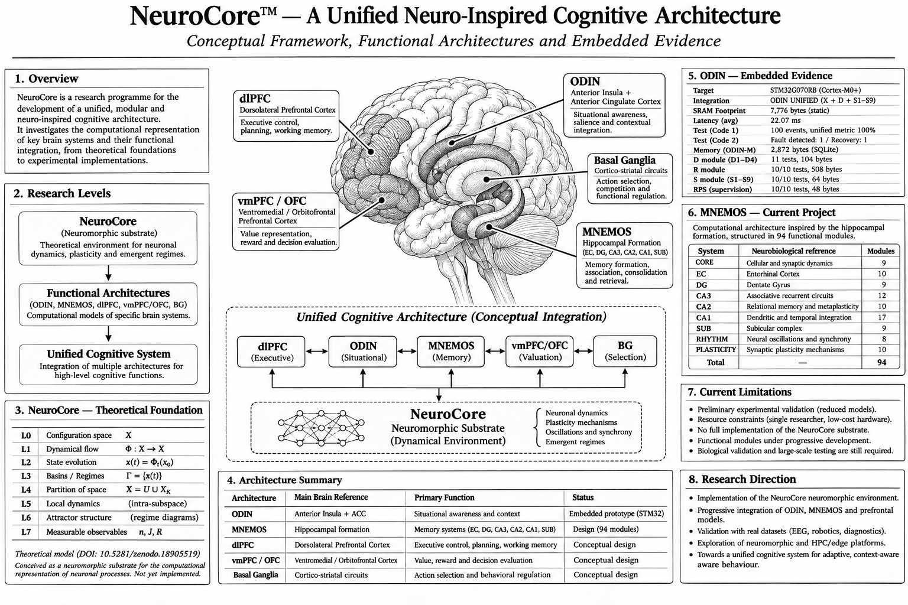

# ODIN Native RC1 — Neuro-Inspired Functional Architecture (STM32G070)[](https://doi.org/10.5281/zenodo.24596897)

**ODIN Native RC1** is a freestanding ISO C++17 bare-metal prototype investigating computational functions associated with situational awareness, inspired by the anterior insula and anterior cingulate cortex (ACC). It is designed and evaluated on an inexpensive, resource-constrained microcontroller (**STM32G070RBTX**, ARM Cortex-M0+, 36 KB SRAM, no hardware FPU) with **zero dynamic memory allocation**.

ODIN is a constituent architecture within the broader **NeuroCore** independent research programme (theoretical disclosure: [doi:10.5281/zenodo.18905519](https://doi.org/10.5281/zenodo.18905519)).

> **Scope & Epistemic Notice:** RC1 is a reduced embedded proof-of-feasibility operating in **advisory-only** mode under synthetic validation protocols. It does not run on the proposed NeuroCore neuromorphic substrate, and no claim of biological equivalence, general cognition, or superiority over existing neuromorphic or embedded ML systems is made.

---

## Architectural Overview


*Figure 1. Conceptual organization of the NeuroCore research programme, functional separation between ODIN, MNEMOS, and prospective architectures, and preliminary STM32G070 embedded evidence.*

### Synchronous Pipeline (`odin::native::Engine::tick()`)
ODIN RC1 integrates nine functional domains plus runtime integrity supervision within a deterministic, statically allocated pipeline:

1. **S (Internal State & Continuity):** Dual-channel fusion, outlier gating ($\pm 3.5\sigma$), kinematic coasting, and CRC32 integrity.
2. **RPS (Runtime Integrity Supervision):** CRC, watchdog, current/temperature checks with atomic `SAFE_HOLD` abort.
3. **P (Perception):** Input ingestion, 4-step predictive rollout, and advisory planning.
4. **M — Recall (Local Associative Memory):** Bounded associative prototype recall with statistical gating ($K_c = 1.441$).
5. **C (Context):** Contextual projection, temporal continuity, MAD deviation, and prequential SGD.
6. **D (Discrimination):** Temporal delta (D1), Gaussian classification with abstention (D2), segmentation (D3), and state confirmation (D4).
7. **R (Relevance):** Explicit/endogenous evidence selection and abstention flagging.
8. **X (Metacognition & Uncertainty):** Q15 kernel with adaptive gain and consolidation gating (`actuation = false`).
9. **K/A (Causal Modelling & Adaptation):** K1–K6 and A1–A6 Q16.16 bus.
10. **M — Observe:** Protected episodic write, journal update, and global CRC32.

---

## Hardware Evidence (STM32G070RBTX)

All measurements were collected on physical silicon (**STM32G070RBTX**, ARM Cortex-M0+, 36,864 B SRAM, 64 MHz reference clock, no FPU) and exported via GDB (`validation/ODIN_NATIVE_RC1_Validation.txt`).

| Metric | ODIN Native RC1 Result |
| :--- | :--- |
| **Synthetic Validation Protocols** | `10 / 10` PASS (`V01`–`V10`) |
| **Physical Ticks Executed** | `381 / 381` |
| **Anomalies Intercepted / Recoveries** | `7 / 3` |
| **Static SRAM Footprint (Engine + Output)** | `8,172 B` (`7,776 B` engine + `396 B` output — **22.17%** of SRAM) |
| **Dynamic Heap Allocation** | `0 B` (zero `malloc`/`new`) |
| **Mean Full-Path Execution** *(excl. V06/V09 aborts)* | `1,412,212` cycles (`22.07 ms` @ 64 MHz) |
| **Peak Observed Execution (`V10`)** | `2,020,700` cycles (`31.57 ms` @ 64 MHz) |
| **Fast Safety Abort (`V09` / `V06`)** | `30,036` cycles (`0.47 ms`) / `58,055` cycles (`0.91 ms`) @ 64 MHz |


*Figure 2. Average SysTick cycles and projected tick latency (16 MHz vs 64 MHz) across validation protocols V01–V10.*

---

## Repository Structure

```text
.
├── Inc/                                      # Freestanding C++17 headers for all ODIN RC1 modules
├── Src/                                      # Core implementations and STM32 entry point (main.cpp)
├── Tests/                                    # Smoke test and summary results
├── GDB/                                      # GDB script used to export on-target telemetry
├── validation/
│   └── ODIN_NATIVE_RC1_Validation.txt        # Raw GDB dump from STM32G070RBTX campaign
├── docs/
│   ├── NC_Research_Dossier.pdf               # Full conceptual & experimental research dossier
│   └── rc1_cycles_latency.png                # Cycle & latency profile across V01–V10
├── B65F67E4-F985-470E-91D7-BEB47E2669C6.png  # NeuroCore & ODIN architectural poster
├── SOURCE_TRACEABILITY.csv                   # File-level traceability map
├── LICENSE                                   # All Rights Reserved (PolyForm Noncommercial License 1.0.0)
└── README.md
